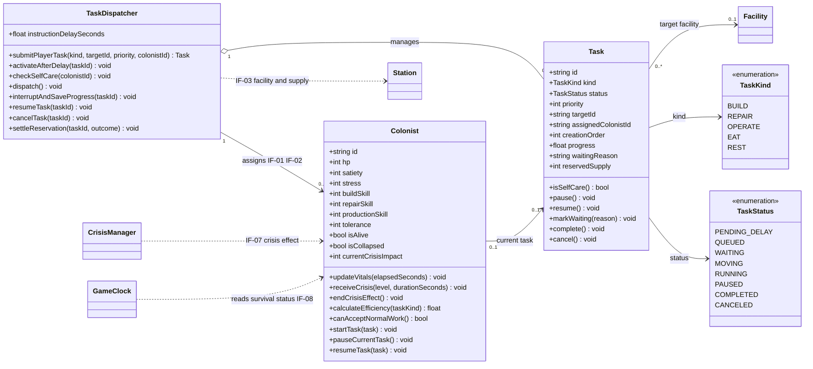

# 殖民者與間接控制類別圖（Colonist & Indirect Control Class Diagram）

- **負責人**：張晏碩
- **需求依據**：[`SRS v1.0`](../req/SRS.md)（Git tag：`srs-v1.0`）
- **對應需求**：`FR-COL-01～28`、`FR-CTL-01～14`、`FR-STN-05～07`、`FR-STN-22～24`、`FR-CRI-09`、`IF-01～03`、`IF-07～08`
- **圖表範圍**：本圖詳細定義 `Colonist`、`TaskDispatcher`、`Task` 及其列舉型別；其他組員負責的類別只顯示名稱與關聯。

## 類別圖

## 設計說明

以下為**設計階段的類別與資料結構決定**；生命值、飽食度、壓力、危機、排程優先度及資源消耗的**實際規則與數值均以 SRS v1.0 為準**，不在此新增功能需求。

1. **用一個 `Task` 類別表示所有任務。** 一般工作使用 `BUILD`（建造）、`REPAIR`（維修）、`OPERATE`（操作設施）；特殊自我照顧使用 `EAT`（進食）、`REST`（休息）。特殊任務身分不另存布林欄位；改由 `Task.isSelfCare()` 依 `kind` 是否為 `EAT`／`REST` 即時計算，避免出現 `kind=EAT` 但標記為一般工作的矛盾。特殊任務雖顯示優先度 5，仍高於任何一般工作（含一般優先度 5），特殊任務之間按建立順序處理。`creationOrder` 用來穩定排序同級任務（`FR-CTL-02～06`、`FR-COL-14`）。
2. **`TaskStatus` 是內部管理狀態，不是新的遊戲功能。** `PENDING_DELAY` 表示玩家指令尚未經過預設 1 秒延遲；`QUEUED`、`WAITING`、`MOVING`、`RUNNING`、`PAUSED`、`COMPLETED`、`CANCELED` 用來區分待分派、等待原因、移動、執行、中斷、完成與取消。`instructionDelaySeconds` 應讀取設定值，初值依 SRS 為 1 秒；特殊自我照顧任務不套用玩家指令延遲（`FR-CTL-04`、`FR-CTL-12`、`FR-CTL-14`、`NFR-07`）。
3. **`Task.progress` 採 0.0～1.0 的完成比例。** 因 SRS 僅要求被中斷的工作保留原進度、未指定進度資料型別，此處用比例避免將各種工作的進度綁定成同一個秒數。`TaskDispatcher` 中斷任務時不清除 `progress`；恢復時沿用該值。相同優先度的一般任務不能主動搶占；特殊自我照顧任務也不互相主動搶占（`FR-CTL-05～07`、`FR-CTL-13`）。
4. **殖民者狀態及效率由 `Colonist` 負責。** `updateVitals(elapsedSeconds)` 累積經過時間，套用 SRS 已規定的飽食度、壓力、飢餓傷害、休息與恢復週期；`calculateEfficiency(taskKind)` 依三項固定專長、飽食度、壓力及危機影響計算效率。`isCollapsed` 與 `isAlive` 分開保存：心理崩潰禁止一般工作但仍會休息；死亡後不能再執行任務（`FR-COL-01～09`、`FR-COL-11～12`、`FR-COL-15～25`）。
5. **自我照顧任務由分派器統一建立與去重。** `checkSelfCare()` 根據殖民者當下狀態及可用物資，確認是否需要進食或休息，並避免同一人存在多個同類型有效自動任務。無法預留物資的未開始進食任務應取消，而不是放入 `WAITING`；正在進食、已預留物資者不因可用量降為 0 而被取消。壓力達 50 時立即標記 `isCollapsed=true` 並停止一般工作；若此刻已在進食，依 `FR-CTL-06` 先完成既有進食，再轉入崩潰休息，期間不得恢復一般工作；休息任務仍依壓力降至 20 的門檻完成（`FR-COL-13～14`、`FR-COL-22～28`）。
6. **資源的唯一管理來源仍在 `Station`，本圖不重複定義 `SupplyStock`。** `TaskDispatcher` 透過 `IF-03` 向太空站請求預留、完成扣除及取消釋放；`Task.reservedSupply` 只記錄該任務持有的預留數量，不代表第二份庫存。進食固定預留 1 單位物資，建造依建造成本預留；同一筆預留只允許結算一次，並維持 `0 ≤ R ≤ F`（`FR-COL-10`、`FR-COL-26～27`、`FR-STN-22～24`）。
7. **目前任務的關聯基數為可選。** `Colonist "0..1" --> "0..1" Task` 表示殖民者同一時間最多執行一項目前任務，而一項任務也最多由一名殖民者當前執行；待命殖民者和仍在佇列、尚未指派的任務都允許沒有這項關聯。分派器仍可管理多項待處理任務；被暫停的任務由 `Task` 的狀態及已指派識別保存，而不是另一項「目前執行」關聯（`FR-CTL-03`、`FR-CTL-07`、`FR-CTL-11～13`）。
8. **跨組類別只保留關聯。** `Facility` 是 `Task` 的可選設施目標（進食、休息任務可沒有設施目標）；`Station` 經 `IF-03` 提供設施可用性與資源結果；`CrisisManager` 經 `IF-07` 向 `Colonist` 傳遞危機等級與持續時間；`GameClock` 經 `IF-08` 取得殖民者存活狀態以判斷全員死亡。這些類別的內部屬性與方法交由施家瑋負責的類別圖定義。

**跨組設計對齊（PR #7，待張晏碩人工確認）**：SRS v1.0 未規定同一殖民者連續遭遇「殖民者狀態惡化」事件的重疊處理。依施家瑋在 `class-station-crisis.md` 提出的設計決定：**不疊加效果**；前一次 30 秒危機尚未結束又收到新事件時，採兩次事件中較高的等級 `L=max(舊等級, 新等級)`，並從新事件開始重新計時 30 秒。`Colonist.receiveCrisis(level, durationSeconds)` 依此更新單一有效危機，`currentCrisisImpact` 記錄依目前等級與耐受性計算的 `D=max(0,L−tolerance)`；不重複套用已被取代的危機效果。這是設計階段對齊方案，不是新增 SRS 需求；由張晏碩在 Gate 2 親自確認。
