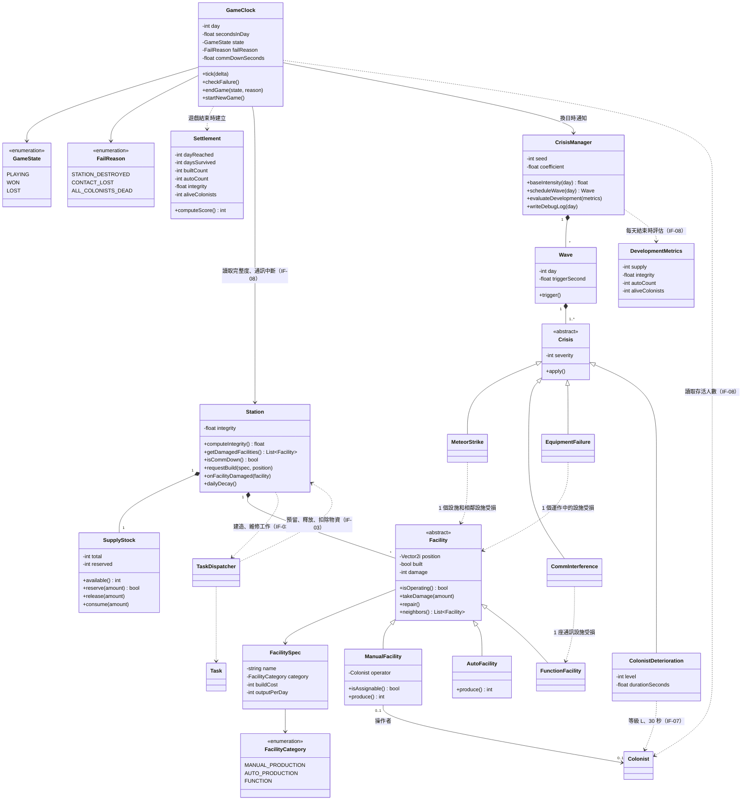

# 太空站與危機類別圖

- **負責人**：施家瑋（A）
- **依據**：SRS v1.0 §3.1 `FR-CORE-01`～`15`、§3.2 `FR-STN-01`～`24`、D-STN-1～4、§3.3 `FR-CRI-01`～`14`、§4.2 `IF-03`、`IF-05`～`IF-08`、`NFR-08`、`NFR-09`
- `Colonist`、`TaskDispatcher`、`Task` 由張晏碩負責（`class-colonist-control.md`），本圖只畫名稱與關聯。

## 設計說明

只寫 SRS 沒有規定、畫圖時才決定的事：

- **設施的分類用繼承表示**：`ManualFacility`、`AutoFacility`、`FunctionFacility` 對應 D-STN-1 的人工生產、自動化生產、功能設施。只有 `ManualFacility` 有 `operator` 和 `isAssignable()`，對應 `IF-03` 的「可指派狀態只有人工生產設施有」。人工農田和自動化農田是同一種產出、不同類別的兩個 `FacilitySpec`。
- **設施規格與設施分開**：`FacilitySpec` 記名稱、類別、建造成本、每天產出，對應 `NFR-07` 數值要集中在設定檔、不改程式碼就能調整。
- **物資庫存只有一份**：`SupplyStock` 屬於 `Station`。建造和進食的預留、釋放、扣除，都由 `TaskDispatcher` 透過 `IF-03` 向 `Station` 提出，再由 `Station` 轉給 `SupplyStock` 的 `reserve()`、`release()`、`consume()`；`Station` 是物資的唯一管理邊界，和張晏碩的 `seq-command.md` 一致（`FR-STN-22`、`FR-STN-24`、`FR-COL-26`、`FR-COL-27`）。`available()` 回傳 `total - reserved`。
- **同一名殖民者的危機效果不疊加**（SRS 沒有規定，PR #7 決定）：殖民者在前一次「殖民者狀態惡化」的 30 秒還沒結束時又被選中，以新事件**覆蓋**舊事件：等級取兩次中較高者，持續時間從新事件開始重新計時 30 秒。理由是疊加會讓 D 在短時間內翻倍，可能一次致命，違背客戶「不會因為單一事件而直接失敗」（訪談 #1 A-Q7）。`Colonist.receiveCrisis()` 依此處理。
- **完整度的公式**（`Station.computeIntegrity()`，`FR-STN-12`、`13` 規定在設計階段決定）：

  > 完整度 = max(0, 100 − 0.2 × 所有設施損壞程度的總和)

  - **為什麼用加總，不用平均**：SRS 3.2 要求「多蓋設施本身不能讓完整度上升」。用平均時，多蓋幾座沒受損的便宜設施就會把平均拉低，玩家可以靠灌設施數避免輸；用加總，損壞的嚴重程度不受設施數量影響，只能靠維修來救，符合客戶要的「連鎖崩壞」（訪談 #1 A-Q7）。取捨是：完整度量的是「總共壞了多少」，不是「還剩幾成是好的」，大太空站和小太空站都是壞到相同程度就輸。
  - **數值檢查**：1 座設施全毀扣 20 個百分點；約 4 座全毀（損壞總和 ≥ 376）時完整度低於 25%，觸發失敗（`FR-CORE-08`），和 SRS 3.1 說明「至少要 4 次事件」一致。係數 0.2 放在設定檔，依試玩調整（`NFR-07`）。
  - **對危機的限制**：`FR-STN-18` 規定單一事件直接造成的完整度下降不超過 20 個百分點，換算後，**一次事件對所有設施（含隕石波及的相鄰設施）造成的損壞加總，不能超過 100 個百分點**。實作 `Crisis.severity` 的換算時要遵守。
- **連鎖損壞由 `Station.dailyDecay()` 處理**：每天換日時，對每個受損設施 +10 個百分點；損壞達 50% 以上的設施，再讓 `neighbors()` 各 +5 個百分點（`FR-STN-17`）。
- **維修工作不重複**：`Station.onFacilityDamaged()` 只在該設施還沒有有效的維修工作時，才向 `TaskDispatcher` 建立一項（`FR-STN-23`）。
- **失敗判定集中在 `GameClock.checkFailure()`**：每次 `tick()` 都檢查完整度 < 25%、通訊中斷累計 120 秒、殖民者全滅三個條件（`FR-CORE-08`～`10`）。`commDownSeconds` 在任一座通訊設施修好時歸零。
- **危機的亂數由 `CrisisManager.seed` 決定**，同一個種子、同樣的操作會得到同樣的危機序列（`NFR-08`）；`writeDebugLog()` 只寫到紀錄檔，不顯示在畫面上（`NFR-09`、`FR-CRI-14`）。
- **`Crisis.severity`**：隕石等設施類危機的嚴重度換算留到實作；`ColonistDeterioration` 的嚴重度就是 `level`（`FR-CRI-09`）。
