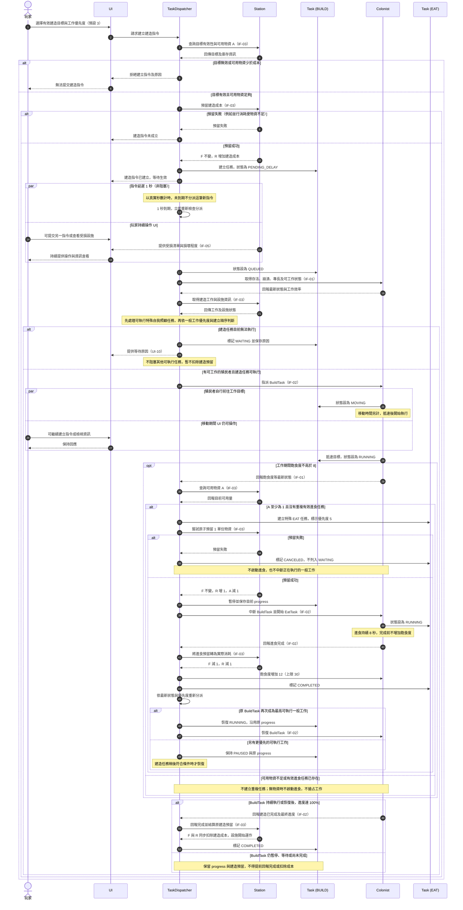

# 指令循序圖（Command Sequence Diagram）

- **負責人**：張晏碩
- **需求依據**：[`SRS v1.0`](../req/SRS.md)（Git tag：`srs-v1.0`）
- **對應需求**：`FR-CTL-01～14`、`FR-COL-10`、`FR-COL-13～14`、`FR-COL-26～27`、`FR-STN-02～03`、`FR-STN-22`、`FR-STN-24`、`UI-06`、`UI-10`、`IF-01～03`、`IF-05`。
- **相關驗收情境**：`AC-B-01～03`、`AC-B-05`、`AC-B-10`（本圖僅完整展開代表性的建造及進食成功流程；其他情境在設計說明列出，不代表已完整畫出每一個驗收案例）。
- **圖表範圍**：以玩家建立建造指令為主，呈現目標驗證、物資預留、非阻塞的 1 秒延遲、工作分派、移動、執行、特殊進食中斷與進度恢復。用條件分支確保**只有真正完成的建造工作才會扣除預留物資**。

## 指令循序圖

## 設計說明

以下僅說明**設計階段的互動安排和繪圖取捨**；工作優先度、數值門檻、資源消耗、休息與危機等需求仍以 SRS v1.0 為準，不在此新增玩法。

1. **介面方向依 SRS §4.2 修正。** 玩家透過 `UI` 提交建立建造工作的請求，`TaskDispatcher` 再透過 `IF-03` 向 `Station` 取得目標、設施與物資資訊。先前版本將 `UI → Station` 的查詢誤標為 `IF-03`，這次已修正；太空站提供給 UI 的受損設施清單使用 `IF-05`。`UI` 只是循序圖中的介面參與者，不是新增的遊戲核心類別。
2. **建造預留與指令延遲分開處理。** 透過 `Station` 再次嘗試不可重複占用的物資預留，以處理驗證與真正建立指令之間的庫存變化；預留成功後才建立 `Task (BUILD)`，並在 1 秒真實時間過後生效。延遲與殖民者移動都不阻塞 UI。`PENDING_DELAY`、`QUEUED` 等仍是 `Task` 的內部狀態，沒有新增玩家操作（`FR-STN-03`、`FR-STN-22`、`FR-CTL-04`、`FR-CTL-14`）。
3. **只有任務完成才可結算建造成本。** 原圖的「進食完成後有條件恢復建造」分支，可能接著無條件回報建造完成。這次改成由 `BuildTask` **真正達成 100% 進度**的分支，才通知 `Station` 扣除建造預留並使設施開始運作；若任務仍暫停、等待或未完成，必須保留原進度與預留。玩家取消未完工建造時，需依 `FR-STN-22` 釋放預留且不扣除總量；這個取消流程不在本張主要成功情境中展開。
4. **`TaskDispatcher` 統一判斷工作是否可執行。** 分派時取得 `IF-01` 的殖民者狀態與 `IF-03` 的太空站資訊。不能執行的一般工作標記 `WAITING` 並顯示原因，不阻塞其他工作。特殊自我照顧任務高於任何一般工作；一般工作依 1～5 級優先度排序，同級按建立順序，且同級一般工作不得主動互搶（`FR-CTL-02～03`、`FR-CTL-05～06`、`FR-CTL-11～12`）。
5. **特殊進食屬於同一個 `Task` 類別。** `Task (BUILD)` 和 `Task (EAT)` 只是兩個不同實例。飽食度≤8 時，先確認可用物資，再確保沒有重複有效進食任務；開始前必須成功預留 1 單位，才可以中斷一般工作，並保存 `progress`。預留失敗的未開始進食任務必須取消且不可列為等待；已經開始、持有合法預留的進食任務不得僅因可用量歸零而取消。進食滿 8 秒才同時扣除總量與預留，並增加最多 12 點飽食度（上限 30）。進食完成後須**重新分派**，不是無條件恢復舊工作（`FR-COL-10`、`FR-COL-13～14`、`FR-COL-26～27`、`FR-CTL-07`、`FR-CTL-13`）。
6. **物資只有一份。** 本圖由 `Station` 代表物資管理邊界，資料最終由太空站子系統的 `SupplyStock` 管理；圖上不重複畫它的內部邏輯。建造與進食都遵守 `F`＝總量、`R`＝預留量、`A=F−R`、`0≤R≤F`。取消進食或殖民者死亡導致未完成時，須釋放該任務預留，且不得增加飽食度；預留不可重複結算。此處僅展開進食**正常完成**的路徑，取消與死亡由 `state-colonist.md` 及 SRS 驗收案例 `AC-B-04`、`AC-B-09` 補充（`FR-COL-27`、`FR-STN-24`）。
7. **本圖是代表性情境，而非所有驗收案例的完整測試軌跡。** 例如兩人同時爭用最後一份食物、庫存補充後重新評估，以及工作取消與死亡的全部分支，須在後續測試以 `AC-B-01～10` 驗證。圖上的互動標籤用來表達協作責任，並非已決定的 Godot node、signal 或具體函式簽名；若施家瑋的 `Station`／`SupplyStock` 設計採不同傳遞方式，須在 PR #7 共同確認一致。
