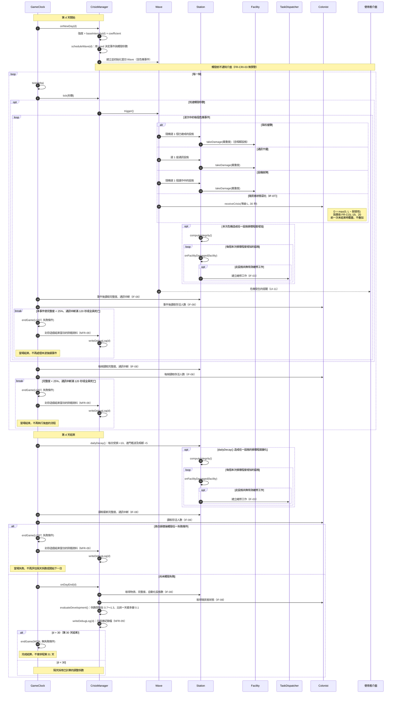

# 危機觸發循序圖

- **負責人**：施家瑋（A）
- **依據**：SRS v1.0 `FR-CRI-01`～`04`、`06`～`14`、`FR-STN-13`、`16`、`17`、`23`、`FR-CORE-05`、`06`、`08`～`10`、`IF-03`、`IF-07`、`IF-08`、`UI-11`、`NFR-08`、`NFR-09`
- 類別見 `class-station-crisis.md`。`TaskDispatcher`、`Colonist`、使用者介面由張晏碩負責，本圖只畫訊息。
- 情境：一個遊戲天之內，從排程危機波次、觸發事件，到換日時評估發展狀況。

## 設計說明

只寫 SRS 沒有規定、畫圖時才決定的事：

- **危機在換日時就排好**：`onNewDay()` 通知 `CrisisManager`，由它自己的 `scheduleWave(day)` 方法依亂數種子建立並初始化當日 `Wave`（含事件與觸發秒數），與 `class-station-crisis.md` 的方法歸屬一致。同一個種子、同樣的操作會得到同樣的序列（`NFR-08`）；排好之後到觸發前都不通知介面，所以沒有任何預兆（`FR-CRI-03`）。
- **受損設施逐一處理**：隕石撞擊可能同時波及目標設施和多個相鄰設施（`FR-CRI-06`），因此一次危機造成損壞後，先統一重算完整度，再逐一對本次損壞程度增加的設施呼叫 `onFacilityDamaged(facility)`，每座設施僅在不存在有效維修工作時才建立新任務（`FR-STN-16`、`FR-STN-23`）。這與換日時處理多座設施損壞的流程一致。
- **每個危機事件後及每一幀都檢查失敗**：每個波次可能有多個危機事件，因此一次事件造成設施損壞、更新完整度與通知介面後，就立即由 `GameClock` 取得最新資訊並檢查失敗；若條件成立，使用 `break` 中止後續危機事件與遊戲流程。非危機造成的通訊超時、殖民者死亡等，也在每次 `tick` 後檢查，符合 `FR-CORE-06`。遊戲結束當天仍需留下 `NFR-09` 的除錯紀錄，但封存紀錄不代表繼續推進遊戲。
- **換日的順序**：先執行 `dailyDecay()`，其中包含既有受損設施每天 +10 個百分點，以及達 50% 後對相鄰設施的 +5 個百分點（`FR-STN-17`）；**只要任一設施損壞程度有增加**，就重新計算完整度，逐一檢查該設施是否需要建立唯一的維修任務（`FR-STN-16`、`23`）。其後立即檢查三項失敗條件；如果失敗，直接結束，不執行隔日難度評估。如果沒有失敗，才記錄本日發展指標並計算隔天係數。這是張晏碩在 PR #7 指出並補強的處理順序。
- **失敗後不再往下執行**：單個危機事件及每一幀的失敗判定均使用 `break`；換日用 `alt` 分成「失敗」與「尚未失敗」兩條路，不會在失敗後繼續危機處理、隔天係數評估或推進遊戲（`FR-CORE-06`）。在結束時寫入的 `NFR-09` 除錯紀錄僅供驗證，不屬於遊戲流程。
- **第 30 天的勝利判定（設計階段順序選擇，待 Gate 2 人工確認）**：第 30 天結束先處理當天的每日損壞並檢查失敗條件；若沒有失敗，仍完成當日的開發指標評估和除錯紀錄，再由 `GameClock.endGame(WON)` 結算勝利（`FR-CORE-05`、`NFR-09`）。日結計算出的係數不會用於第 31 天，也不會啟動新一天。這個先後順序不是 SRS 明文規定的唯一實作順序，須由組員在 Gate 2 核准。
- **危機提醒在事件之後才送出**：`UI-11` 的提醒只在 `trigger()` 之後出現，提醒的內容不包含調整係數（`FR-CRI-14`）。
