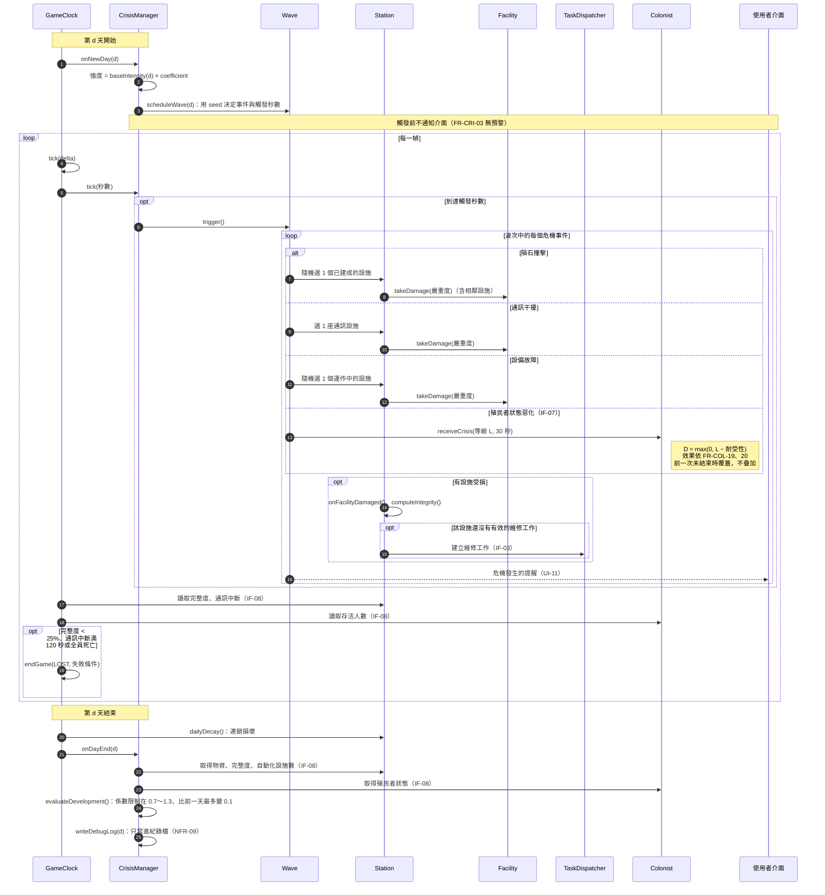

# 危機觸發循序圖

- **負責人**：施家瑋（A）
- **依據**：SRS v1.0 `FR-CRI-01`～`04`、`06`～`14`、`FR-STN-16`、`17`、`23`、`FR-CORE-06`、`08`、`IF-03`、`IF-07`、`IF-08`、`UI-11`、`NFR-08`、`NFR-09`
- 類別見 `class-station-crisis.md`。`TaskDispatcher`、`Colonist`、使用者介面由張晏碩負責，本圖只畫訊息。
- 情境：一個遊戲天之內，從排程危機波次、觸發事件，到換日時評估發展狀況。

## 設計說明

只寫 SRS 沒有規定、畫圖時才決定的事：

- **危機在換日時就排好**：`onNewDay()` 用亂數種子決定當天的事件與觸發秒數，同一個種子、同樣的操作會得到同樣的序列（`NFR-08`）；排好之後到觸發前都不通知介面，所以沒有任何預兆（`FR-CRI-03`）。
- **失敗判定每一幀都做**：`GameClock` 在每次 `tick` 後檢查三個失敗條件，所以觸發的當下就結束遊戲，不必等到換日（`FR-CORE-06`）。
- **換日的順序**：先做連鎖損壞（`dailyDecay()`），再評估發展狀況。這樣評估用的完整度已經包含當天的連鎖損壞，隔天的係數比較能反映玩家的實際狀況。
- **危機提醒在事件之後才送出**：`UI-11` 的提醒只在 `trigger()` 之後出現，提醒的內容不包含調整係數（`FR-CRI-14`）。
