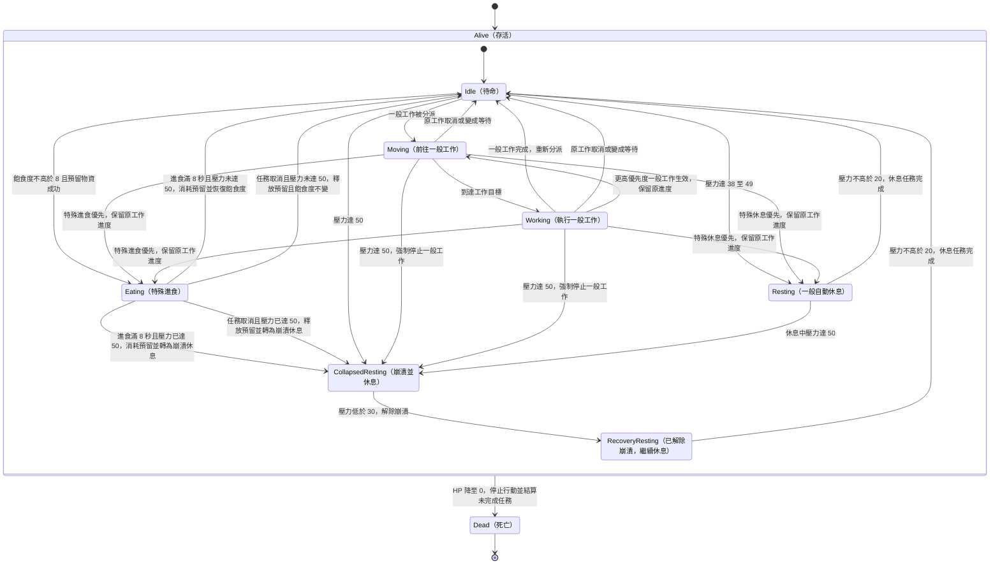

# 殖民者狀態圖（Colonist State Diagram）

- **負責人**：張晏碩
- **需求依據**：[`SRS v1.0`](../req/SRS.md)（Git tag：`srs-v1.0`）
- **對應需求**：`FR-COL-01～14`、`FR-COL-18～28`、`FR-CTL-03～08`、`FR-CTL-11～13`、`FR-CRI-09`、`FR-CORE-10`、`IF-01～02`、`IF-07～08`
- **圖表範圍**：表示單一 `Colonist` 的活動狀態及心理崩潰、死亡的轉換；任務本身的狀態（例如 `QUEUED`、`PAUSED`、`WAITING`）仍由類別圖中的 `Task.status` 保存。

## 殖民者狀態圖

## 設計說明

以下僅說明**設計階段的狀態拆分、責任歸屬與圖示簡化**。觸發門檻、數值及優先規則均以 SRS v1.0 為準；本圖不增加新需求。

1. **將「活動狀態」和 `Task.status` 區分。** `Idle`、`Moving`、`Working`、`Eating`、`Resting` 等描述殖民者目前在做什麼；工作是否為 `PENDING_DELAY`、`QUEUED`、`WAITING`、`PAUSED`、`COMPLETED` 或 `CANCELED`，則由 `TaskDispatcher` 與 `Task.status` 管理。`Moving` 在本圖只表示前往一般工作的目標，指令的 1 秒延遲不畫成殖民者狀態（`FR-CTL-04`、`FR-CTL-08`）。
2. **休息拆成三種圖示狀態，以區分「解除崩潰」與「完成休息」。** `Resting` 是壓力達 38～49 觸發的普通自動休息；`CollapsedResting` 表示壓力達 50 時 `isCollapsed=true`，必須停止一般工作並休息；當壓力低於 30，先轉入 `RecoveryResting` 並將 `isCollapsed=false`，但**不能立刻恢復一般工作**，必須繼續休息至壓力不高於 20。三個狀態並非三種不同任務，`Task.kind` 仍都是 `REST`（`FR-COL-22～23`、`FR-COL-25`、`FR-COL-28`）。
3. **特殊進食須先預留物資才可轉入 `Eating`。** `TaskDispatcher.checkSelfCare()` 判斷飽食度不高於 8 且可用物資至少 1；真正開始進食時，必須由 `Station` 的同一物資庫存成功預留 1 單位。進食 8 秒完成時才扣除預留，並恢復 12 點飽食度（上限 30）。預留失敗的任務取消，不會進入 `Eating` 或等待狀態；進食中若因玩家取消而未完成，壓力未達 50 時回到 `Idle`，壓力已達 50 時轉入 `CollapsedResting`；兩者都由 `Station` 釋放該次預留（`R−1`、`F` 不變），不可增加飽食度、重複結算，之後交由 `TaskDispatcher` 重新檢查與分派；若因死亡而未完成，則走 `Alive → Dead` 共通出口，同樣釋放預留。**可用物資減至 0 本身不構成取消已開始進食的理由**（`FR-COL-10`、`13～14`、`26～27`；`AC-B-03～04`、`AC-B-09`）。
4. **優先度切換由分派器決定，不另建殖民者狀態。** 一般工作優先度為 1～5；較高優先度的一般工作可以中斷較低優先度工作，特殊自我照顧任務高於任何一般工作。中斷時保留 `Task.progress`，任務完成後先回到 `Idle` 交由 `TaskDispatcher.dispatch()` 重新判斷；不保證直接恢復原任務。**兩項特殊自我照顧任務不互相主動中斷**。若進食期間壓力達 50，立即設定 `isCollapsed=true`，但繼續目前進食；進食完成後才轉入 `CollapsedResting`，不經一般工作分派。圖中的 `Eating → CollapsedResting` 是進食結束（或玩家取消）後的轉換，並非休息任務搶占進食（`FR-COL-14`、`FR-CTL-03`、`05～07`、`13`）。
5. **死亡是存活狀態的共通出口。** 從複合狀態 `Alive` 指向 `Dead` 的箭頭表示：不論殖民者當時是在移動、工作、進食還是休息，只要 HP 降為 0 都停止行動。若有未完成的預留，依任務取消規則釋放；此處 `Dead` 是該殖民者的終止狀態，**只有所有殖民者死亡時**，核心流程才依 `FR-CORE-10` 判定遊戲失敗（`FR-COL-24`、`27`、`IF-08`）。
6. **自然數值變化不另外畫成狀態。** 飽食度每 20 秒下降、工作壓力每累積 20 秒增加、飽食度為零時的生命損失、休息期間的壓力下降與符合條件的生命恢復，以及危機每 10 秒的傷害，均由 `Colonist.updateVitals()`、`receiveCrisis()` 等方法更新資料。危機影響 D 改變效率時，殖民者仍可維持原活動；只有因此跨過壓力 50 或 HP 0 等門檻，才觸發對應狀態轉移（`FR-COL-04～12`、`18～21`；`FR-CRI-09`）。

**PR #7 設計對齊方案（張晏碩已於 PR #7 approve 確認）**：同時考慮 `FR-COL-22`（壓力達 50 立刻進入崩潰狀態，停止一般工作）與 `FR-CTL-06`（特殊進食、休息彼此不主動中斷）。若正在 `Eating` 時壓力升至 50，立即將 `isCollapsed` 設為 `true` 並禁止一般工作；已開始且持有合法預留的進食仍可完成至 8 秒，成功進食後扣除預留並恢復飽食度，**直接轉為 `CollapsedResting`**。若玩家在完成前取消進食，依 `FR-COL-27` 釋放預留且不增加飽食度，仍應轉為崩潰休息；若死亡則由 `Alive → Dead` 處理。另依 `class-station-crisis.md` 的設計決定，重疊危機不疊加、取較高等級並重計時 30 秒。此處僅同步兩圖的設計安排，不更改 SRS；Gate 2 簽核仍由張晏碩自行確認。
