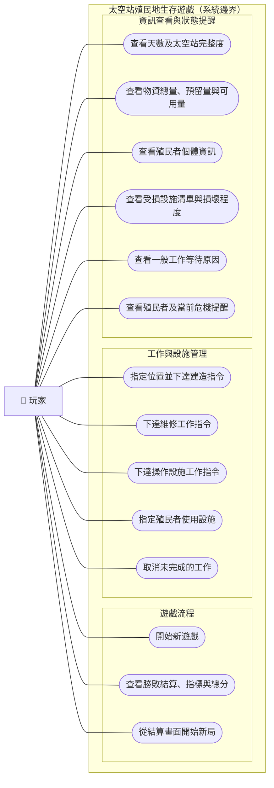

# 使用案例圖（Use Case Diagram）

- **負責人**：張晏碩
- **需求依據**：[`SRS v1.0`](../req/SRS.md)（Git tag：`srs-v1.0`）
- **圖表形式**：以 Mermaid `flowchart` **模擬 UML Use Case 圖**；玩家為參與者、圓角節點為使用案例、`subgraph` 為系統邊界。
- **對應需求**：
  - 遊戲流程：`FR-CORE-01`、`FR-CORE-11～15`、`UI-07`。
  - 工作與設施管理：`FR-STN-02～03`、`FR-STN-14`、`FR-STN-16`、`FR-STN-22～24`、`FR-CTL-01～04`、`FR-CTL-08～10`、`FR-CTL-12`、`FR-CTL-14`、`UI-06`、`UI-10`。
  - 資訊查看與提醒：`FR-CORE-03`、`FR-COL-01`、`FR-COL-15`、`FR-COL-18`、`FR-COL-22`、`FR-COL-24`、`FR-CRI-03`、`FR-CRI-14`、`UI-01～05`、`UI-08～11`。
- **圖表範圍**：只呈現玩家可執行的操作，以及玩家可查看的資訊；每日危機、殖民者自行進食／休息等系統自動行為不視為玩家直接發起的使用案例。

## 使用案例圖

## 設計說明

以下僅記錄**設計階段的圖表表達方式**，不新增 SRS v1.0 未規定的玩法、畫面或操作步驟。

1. **使用者與系統邊界。** 本圖只有「玩家」一個外部參與者；`Colonist`、`TaskDispatcher`、`Station`、`CrisisManager` 都是系統內部的類別或子系統，不當成外部 Actor。將使用案例按遊戲流程、工作管理、資訊查看分組，是為了便於閱讀，不代表需要三個獨立的遊戲畫面。
2. **使用 `flowchart` 作為表示法。** Mermaid 沒有原生 UML Use Case 圖，故以圓角節點和一般關聯線模擬。這些連線僅表示玩家與使用案例的關聯，**不是時間順序或資料流**；本圖不臆造 UML `include`／`extend` 關係。工作指令的詳細順序另見 `seq-command.md`。
3. **三種一般工作。** 建造、維修、操作設施分別列出，對應 `FR-CTL-09`。建立有效工作指令時仍必須先有目標，並設定 1～5 級優先度（預設 3）；建造還要檢查可用物資並預留成本。這些既有前置條件沒有拆成新使用案例，以免把圖畫得過度瑣碎。
4. **指派與操作的差別。** 「下達操作設施工作指令」是工作種類；「指定殖民者使用設施」強調玩家指定特定殖民者與特定可用設施的關聯（`FR-CTL-10`），兩者在操作流程中可以相互配合。只有符合 SRS 的設施類型才需要人工操作；沒有增加可手動操作自動化或功能設施的能力。
5. **資訊顯示不等於新增按鈕。** 天數、太空站完整度與物資資訊依 SRS 屬主畫面常駐顯示；圖中的「查看」表示玩家可取得資訊，**不暗示需要點擊新按鈕**。殖民者個體資訊則可由主畫面的入口開啟。個體面板不展示目前工作及優先度（`UI-05`）；工作優先度在工作指派介面設定。
6. **自動行為與提醒。** 自動進食、休息、工作分派、危機觸發及勝敗判定，都是系統依規則自行執行的行為，不畫成玩家主動使用案例。玩家可以查看殖民者低飽食度／崩潰／死亡提醒與已發生危機的影響，但不會因此獲得危機的事前預告（`FR-CRI-03`、`UI-09`、`UI-11`）。一般工作等待原因可查看；缺食取消的未預留自動進食任務不可誤顯示為等待（`FR-CTL-12`、`UI-10`）。
7. **勝敗與重新開始。** 遊戲結束後系統自動顯示結算，包含結果、天數、失敗原因（若適用）、指定指標及總分；玩家可從結算畫面開始新的一局（`FR-CORE-11～15`）。「查看結算」代表閱讀系統提供的結果，而非玩家手動決定勝敗。
